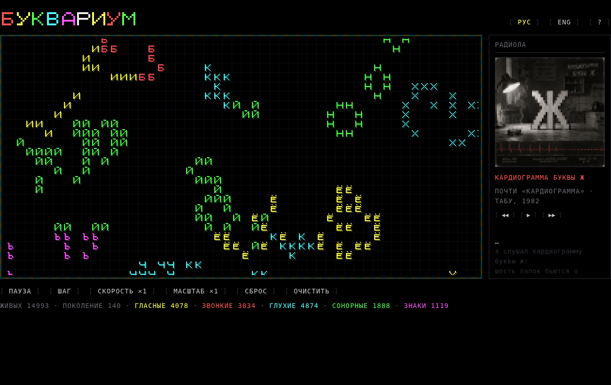
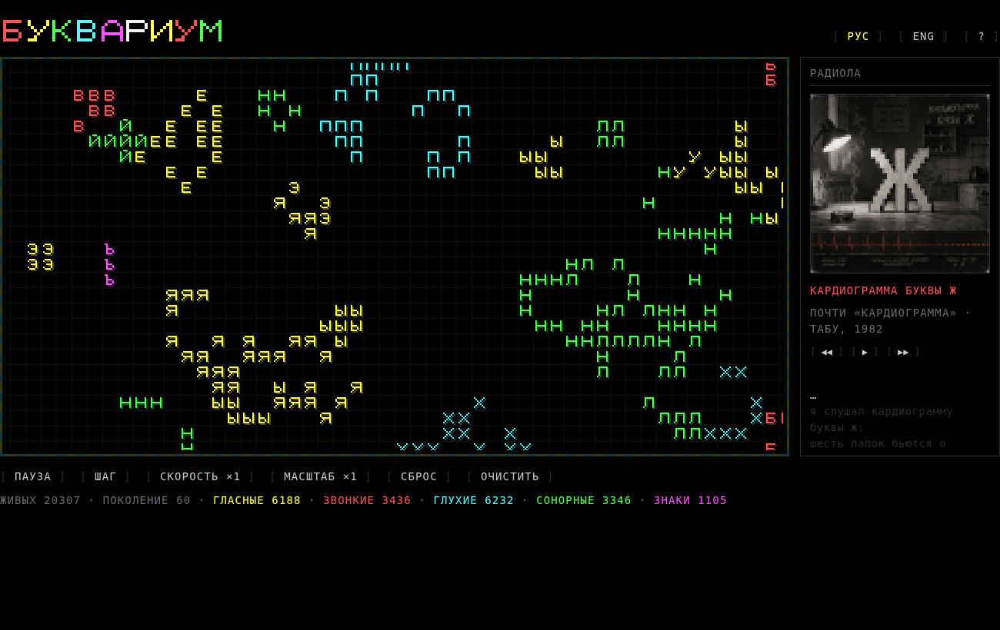
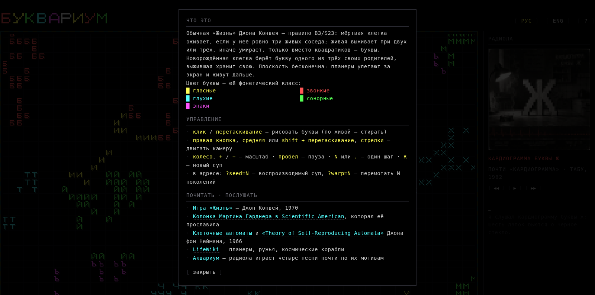
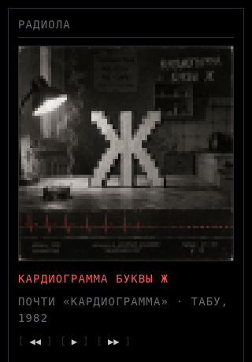

# БУКВАРИУМ

**Conway's Game of Life, except the cells are Cyrillic letters.**

A dependency-free, single-file web toy. Plain B3/S23 on an infinite plane; every live cell is a 7×9 pixel letter, coloured by its phonetic class. A newborn cell inherits the letter of one of its three parents, a survivor keeps its own — so lineages spread and cluster like colonies. In the side panel, a *радиола* plays four songs almost-after-Аквариум about the plane itself.

*Буквариум* = *буква* (letter) + *Аквариум* (the Leningrad band). ZX Spectrum palette, Minecraft-style drop shadows, no build step.



## Try it

Open `index.html` in a browser, or serve the folder with anything static:

```
python3 -m http.server 8080
# → http://localhost:8080/
```

(The radiola needs the page served over HTTP so the browser will stream the MP3s.)

## The rule

- **Birth** — a dead cell with exactly three live neighbours comes alive. It takes the letter of one of the three, at random.
- **Survival** — a live cell with two or three neighbours stays; anything else dies.
- **Colour** — the letter's phonetic class: <span style="color:#ffff55">vowels</span> yellow · <span style="color:#ff5555">voiced</span> red · <span style="color:#55ffff">voiceless</span> cyan · <span style="color:#55ff55">sonorants</span> green · <span style="color:#ff55ff">signs (Ь Ъ)</span> magenta.
- **Afterglow** — when a letter dies, its glyph lingers as a teal phosphor ghost and fades out over about a second, so moving things leave trails like on an old CRT.
- **The plane is (almost) infinite.** The world is stored as 64×64 tiles and only tiles with something alive in them are computed; gliders leave the screen and keep going, out to ±4096 cells. A fresh 480×300 soup is seeded at start, and every 32×32 chunk the camera reaches for the first time is seeded too (deterministically from the seed), so panning never runs out of world.



## Controls

| action | how |
|---|---|
| draw letters / erase | click or drag (over a live cell — erase) |
| pan | right-button, middle-button or shift + drag; arrow keys |
| zoom | mouse wheel, `+` / `−`, or the **масштаб** button |
| pause · step | `space` · `N` or `.` |
| new soup · clear | `R` / **сброс** · **очистить** (clearing also stops auto-seeding) |
| language | **РУС / ENG** in the header — persists in `localStorage` |
| help | **?** in the header |

URL parameters: `?seed=N` reproducible world · `?warp=N` fast-forward N generations · `?lang=en` · `?help`



## Радиола



Four songs *почти по мотивам Аквариума*, written for this page and about it:

1. **Кардиограмма буквы Ж** — after «Кардиограмма» (*Табу*, 1982)
2. **Под небом чёрным** — after «Город золотой» (*Десять стрел*, 1986)
3. **Алфавит мёртв** — after «Рок-н-ролл мёртв» (*День серебра*, 1984)
4. **Б3 / С23** — after «2-12-85-06» (*Дети декабря*, 1985) — the rule as a phone number

Lyrics were written here; the recordings were generated with Suno and the covers with GPT Image, from the prompts in [`radiola_suno.md`](radiola_suno.md). Karaoke lines are timed from the recordings with faster-whisper and follow the language toggle (English glosses in ENG mode). Transport: ◀◀ ▶ ▶▶; tracks auto-advance.

<br clear="all">

## Files

```
index.html        the whole app: font, sim, UI, radiola (~45 KB)
radiola/          4 × MP3, 4 × 80px pixel covers
radiola_suno.md   Suno style prompts + full lyrics, GPT Image cover prompts
screenshots/
```

The 7×9 bitmap font, the sim and the UI all live in `index.html`; there are no dependencies and nothing to build.

## License

[MIT](LICENSE) — code, lyrics, recordings and covers alike. Take it, fork it, remix it.

## Credits

Made by [Anna Brezgis](https://github.com/brezgis). Bowing to Conway, von Neumann, Gardner — and to БГ.
